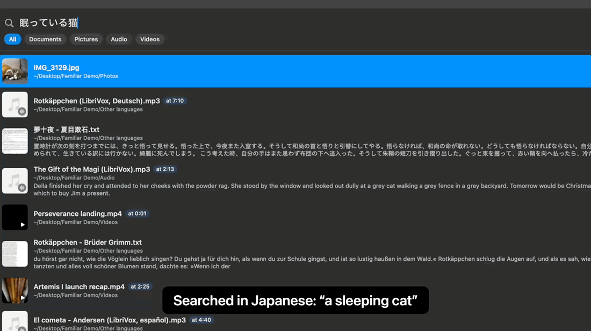
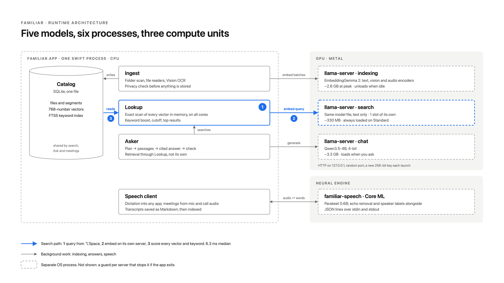

# Familiar

Private AI for your Mac. Three things, all running on your Mac, with nothing you have, say or ask leaving it:

- **Search:** describe a file in your own words and Familiar finds the document, PDF page, picture, recording or video moment that matches.
- **Ask:** questions answered from your files and meetings, with the sources to click through to.
- **Speak:** hold a key and talk to type in any app; record meetings (your microphone and the call's sound, any meeting app, no bot joining) with a transcript and who said what.

> **Not notarized by Apple yet**, so macOS asks you to approve it once (steps below). Found a problem? [Open an issue](../../issues).

## Requirements

- An Apple silicon Mac (M1 or later). Intel Macs aren't supported.
- macOS 13 Ventura or later. Speech (push to talk and meetings) needs macOS 14 Sonoma or later.
- 8 GB of memory or more, and about 5 GB free for the models, downloaded on first launch.
- Speech is English only for now.

## Install

1. Download **Familiar.dmg** from the [latest release](../../releases/latest), open it, and drag Familiar to Applications.
2. Open Familiar. Because it isn't notarized, the first time macOS says:

   > Apple could not verify “Familiar” is free of malware that may harm your Mac or compromise your privacy.

   That's expected for an app that isn't notarized. To open it:
   - **macOS 15 Sequoia and later:** click **Done** (not Move to Trash). Open **System Settings → Privacy & Security**, scroll down to **“Familiar” was blocked to protect your Mac**, and click **Open Anyway**. Open Familiar again, click **Open Anyway**, and enter your password.
   - **macOS 13 and 14:** right-click Familiar in Applications, choose **Open**, then **Open**.

   You only do this once.
3. Follow the four short steps: **Get Started** (the models start downloading), the folders to search, the Microphone and Accessibility permissions (for speech; you can skip them), and a first try of push to talk.

To check the download, compare its SHA-256 with the one in the release notes: `shasum -a 256 ~/Downloads/Familiar.dmg`

## Using it

| Key | What it does |
|---|---|
| ⌥Space | Search your files; press Tab to ask a question instead |
| Hold right ⌥ | Type by talking; let go to finish |

Meetings are recorded from the menu-bar icon. Settings → What to search chooses the folders Familiar reads.

## Privacy

- Your files, questions, recordings and transcripts never leave your Mac. The only network use is downloading the models from Hugging Face, each pinned to a version and checked against its SHA-256.
- It never reads keys, certificates, credentials or password files, by name or by content: a document, PDF, slide, screenshot or recording that holds a private key or a cloud access key stores nothing and is listed as skipped.
- It only reads files; it never changes, moves or uploads them.

## Remove it

Quit Familiar, delete it from Applications, and delete `~/Library/Application Support/Familiar` (models, index, logs), `~/Documents/Familiar Meetings` if you recorded any, and `~/Library/Preferences/io.github.kaushicaravind2000.Familiar.plist`. Then remove it from System Settings → Privacy & Security → Accessibility.

## Updating

After an update, macOS asks again for Accessibility (push to talk), because each experimental build is signed on its own. Choose **Allow Again** when Familiar asks.

## Credits

Familiar was inspired by [DigUp](https://github.com/ARahim3/DigUp) by Abdur Rahim, the open-source file search that first put EmbeddingGemma 2 to work on personal files, and by [Google AI Edge Foresight](https://developers.google.com/edge/foresight), Google's experimental on-device Mac app that pairs EmbeddingGemma 2 with Gemma 4 for meeting notes and local search. Familiar runs [EmbeddingGemma 2](https://huggingface.co/ggml-org/embeddinggemma-2-GGUF) (Google DeepMind) and Qwen3.5-4B on [llama.cpp](https://github.com/ggml-org/llama.cpp), and speech on [FluidAudio](https://github.com/FluidInference/FluidAudio) (Parakeet, LocalVQE, pyannote). Gemma is a trademark of Google LLC. Third-party licences are in the app: Familiar.app/Contents/Resources.

Familiar is an independent project, not affiliated with or endorsed by Google. The app is free to use; its source code isn't public yet.
